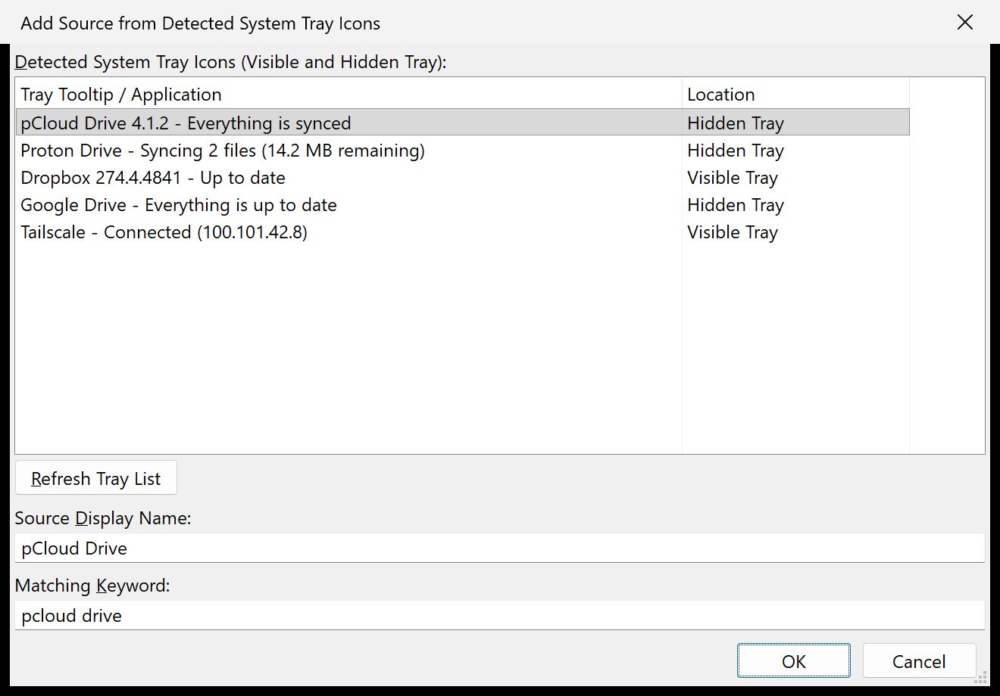
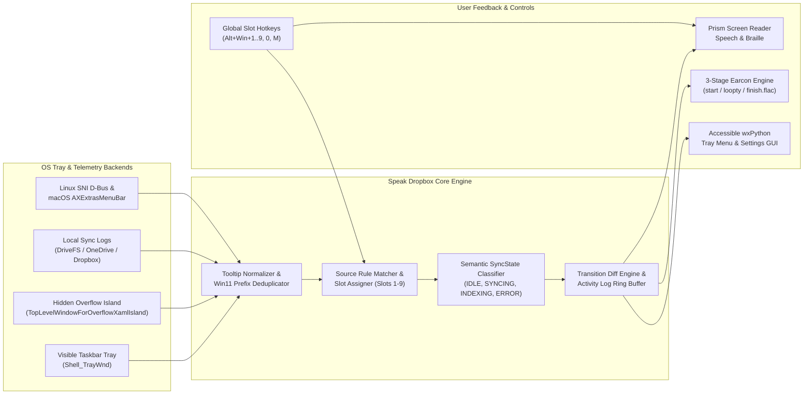

# Speak Dropbox

[](LICENSE)
[](https://www.python.org/)
[](#cross-platform-support)
[](#screen-reader-and-audio-feedback)

**Speak Dropbox** is an accessible system tray and hidden overflow cloud synchronization monitor for blind and keyboard-first users. Inspired by Valiant8086's classic Windows 7 utility, it watches your cloud storage clients in the background and reports when files start syncing, while transfers are in progress, and the moment everything is up to date.

Modern Windows 10 and Windows 11 builds redesigned the notification area around XAML Islands and hidden overflow flyouts, breaking older tray scripts or forcing users to drag every cloud icon onto the main taskbar. Speak Dropbox queries both the visible taskbar tray and the closed "Show hidden icons" overflow window directly in the background without moving your mouse, simulating clicks, or stealing keyboard focus.

Beyond Dropbox, Speak Dropbox monitors **Google Drive**, **Microsoft OneDrive**, **Resilio Sync**, **iCloud Drive**, **Nextcloud**, **Syncthing**, **MEGAsync**, and any custom application in your system tray.

---

## Features

- **Background Visible & Hidden Overflow Monitoring**: Reads status tooltips from both the main taskbar tray and the closed hidden overflow flyout (`TopLevelWindowForOverflowXamlIsland` on Windows 11 22H2/23H2/24H2 and `NotifyIconOverflowWindow` on Windows 10) without opening the flyout or moving the cursor.
- **Multi-Source Cloud Presets & Custom Rules**: Ships with built-in matching rules for Dropbox, Google Drive, OneDrive, Resilio Sync, iCloud, Nextcloud, Syncthing, and MEGAsync. You can also scan your live system tray to add any running application in two keystrokes.
- **Direct Screen Reader Speech & Braille (Prism)**: Announces status transitions and on-demand slot queries directly through your active screen reader (NVDA, JAWS, Windows Narrator, ZDSR, VoiceOver, or Orca) with automatic SAPI / AVSpeech / Speech Dispatcher fallback via [Prism (`prismatoid`)](https://pypi.org/project/prismatoid/).
- **Three-Stage Sync Earcons**: Plays distinct spatial audio cues (`start.flac` when syncing or indexing begins, a gentle periodic `loopty.flac` pulse while transfers remain active, and `finish.flac` when all active sources return to idle).
- **Global Slot Hotkeys (`Alt+Win+1` .. `9`)**: Query individual monitored sources from any application. Double-pressing a slot hotkey within 500 ms copies that source's exact status text to the clipboard.
- **Accessible System Tray Menu & Settings Dialog**: Right-click the Speak Dropbox tray icon (or press `Alt+Win+M`) to inspect active sources, open a provider's local sync folder in your file manager, reorder slots, preview audio cues, or review the timestamped Sync Activity Log.

---

## Screenshots




---

## Quick Start

### Prerequisites

- Python 3.10 or newer
- [`uv`](https://docs.astral.sh/uv/) (recommended for fast, isolated virtual environments)

### Installation

Clone the repository and create a local virtual environment inside the project directory:

```powershell
git clone https://github.com/Aarushb/speak_dropbox.git
cd speak_dropbox
uv venv .venv
uv pip install --python .venv\Scripts\python.exe -e .
```

On macOS or Linux:

```bash
uv venv .venv
uv pip install --python .venv/bin/python -e .
```

### Running Speak Dropbox

Launch the background tray monitor:

```powershell
.venv\Scripts\python.exe -m speak_dropbox
```

To open the **Manage Sources & Settings** window immediately on launch:

```powershell
.venv\Scripts\python.exe -m speak_dropbox --manage
```

### Command-Line Inspection Flags

You can also query your cloud sync status from a terminal or script without keeping the tray app open:

- **Speak and print a summary of all active cloud sources**:
  ```powershell
  .venv\Scripts\python.exe -m speak_dropbox --status
  ```
- **Query a specific slot (1 through 9)**:
  ```powershell
  .venv\Scripts\python.exe -m speak_dropbox --slot 1
  ```
- **List every icon currently discovered in both the visible tray and hidden overflow**:
  ```powershell
  .venv\Scripts\python.exe -m speak_dropbox --list-tray
  ```
- **Print output without speaking aloud**:
  Add `--no-speak` to any one-shot flag (for example, `python -m speak_dropbox --status --no-speak`).

---

## Keyboard Shortcuts

All global hotkeys work from any application while Speak Dropbox is running in the background. You can change the global modifier prefix (`Alt+Win`, `Ctrl+Shift+Win`, `Ctrl+Alt+Shift`, or `Alt+Shift`) in the **Hotkeys & General** tab.

| Shortcut | Context | Action |
| :--- | :--- | :--- |
| `Alt+Win+1` .. `Alt+Win+9` | Global (Anywhere) | Speak the status of monitored source in Slot 1 through 9 |
| `Alt+Win+1` .. `9` (Double-Press) | Global (Anywhere) | Copy Slot 1 through 9 status text to the clipboard and announce confirmation |
| `Alt+Win+0` | Global (Anywhere) | Speak a combined summary of all active monitored sources |
| `Alt+Win+M` | Global (Anywhere) | Open the Manage Sources & Settings dialog |
| `F1` | Inside Any Dialog | Open the Keyboard Shortcuts Reference dialog |
| `Escape` | Inside Any Dialog | Cancel and close the active dialog |

---

## How It Works



**Architecture walkthrough in plain text:**

1. **OS Tray & Telemetry Backends**: On each poll cycle, the platform backend collects live tray tooltips without disturbing window focus. On Windows 11 22H2+, it resolves the `Windows.UI.Input.InputSite.WindowClass` HWNDs inside both `Shell_TrayWnd` (the visible taskbar tray) and `TopLevelWindowForOverflowXamlIsland` (the hidden overflow flyout) and queries cached UI Automation elements in a single cross-process call. On Windows 10, it reads `NotifyIconOverflowWindow` via UIA and falls back to cross-process `ToolbarWindow32` memory inspection if the overflow flyout has not been opened since boot. When a cloud client such as Google Drive exposes only its application name in the hidden tray, a local telemetry adapter enriches the status from `%LOCALAPPDATA%\Google\DriveFS\Logs\drive_fs.txt`.
2. **Tooltip Normalizer & Prefix Deduplicator**: Windows 11 concatenates a tray icon's initial tooltip with its updated tooltip whenever an app modifies its status via `Shell_NotifyIcon(NIM_MODIFY)`. The normalizer strips duplicated multi-clause headers, cleans newline formatting, and optionally removes unread notification counts.
3. **Source Rule Matcher & Semantic Classifier**: Discovered icons are matched against your ordered source rules and assigned to Slots 1 through 9. Each source's status text is classified into a semantic state (`IDLE`, `SYNCING`, `INDEXING`, `PAUSED`, `ERROR`, or `DISCONNECTED`).
4. **Transition Diff Engine & Output Services**: Meaningful state changes are recorded in the in-memory Activity Log and routed to **Prism** for screen reader speech and braille output, as well as the **Audio Cue Service**, which triggers `start.flac` on sync start, repeats `loopty.flac` at your configured interval while any source is transferring files, and plays `finish.flac` when all sources return to `Up to date`.

---

## Cross-Platform Support

- **Windows 10 & Windows 11 (21H2, 22H2, 23H2, 24H2+)**: Full background inspection of both the visible taskbar tray and the hidden overflow tray via `IUIAutomation` and `ToolbarWindow32` fallback, plus local DriveFS, OneDrive, and Dropbox folder/log enrichment.
- **Linux**: Queries `org.kde.StatusNotifierWatcher` and `org.freedesktop.StatusNotifierWatcher` over session D-Bus (`gdbus` / `busctl`) to read `Title` and `ToolTip` properties from background `StatusNotifierItem` services, supplemented by the official `~/.dropbox/command_socket` IPC interface.
- **macOS**: Queries background applications' `AXExtrasMenuBar` status items via System Events / JXA (`osascript`) and checks the local Dropbox socket when available.

---

## Configuration

Settings are saved automatically in JSON format at:

- **Windows**: `%APPDATA%\SpeakDropbox\config.json`
- **macOS**: `~/Library/Application Support/SpeakDropbox/config.json`
- **Linux**: `~/.config/speak_dropbox/config.json`

You can edit every setting through the **Manage Sources & Settings** dialog (`Alt+Win+M`) or pass a custom path via `--config path/to/config.json`.

---

## Contributing & Feedback

If you find Speak Dropbox useful, please consider starring the repository on GitHub so other screen reader and keyboard users can discover it. Bug reports, cloud client tooltip samples, and feature requests are always welcome in [GitHub Issues](https://github.com/Aarushb/speak_dropbox/issues), and pull requests are gladly accepted.

---

## License

Released under the [MIT License](LICENSE).
